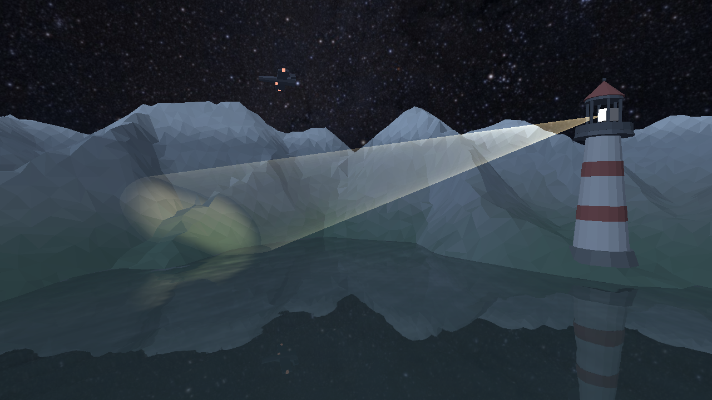

# Mountain Lake & Aurora

> A calm mountain lake under a night sky with a dancing aurora.

Final project for **Computer Graphics Fundamentals** (Astana IT University).
Topic #11 from the *Final Project Topics* list, difficulty ★★ — *course material + one new simple technique*.
The new technique is an **animated aurora shader**.

Planned final scene: a real-time interactive landscape written in **C++** with **OpenGL 3.3 core profile**, featuring mountains built from a heightmap, a semi-transparent lake with strong specular highlights, curved animated aurora ribbons, a starry skybox and a flickering campfire on the shore. The current implementation milestone is described below; the complete course specification remains in this README.

**Planned wow moment (end of the demo video):** the aurora brightens while the camera glides low over the lake.

---

## Contents

- [Status](#status)
- [Features](#features)
- [How the requirements R1–R8 are met](#how-the-requirements-r1r8-are-met)
- [Controls](#controls)
- [Build and run](#build-and-run)
- [Project structure](#project-structure)
- [Technical notes](#technical-notes)
- [Team](#team)
- [Deliverables](#deliverables)
- [Credits](#credits)
- [AI Use note](#ai-use-note)

---

## Status

The current milestone is the **terrain, lake and starry sky**: a low-poly mountain landscape with sharp peaks and clearly visible triangular faces, holding a rippling lake beneath a night cubemap. The complete mountain-lake scene remains the final target.

- CMake builds GLFW and generated GLAD source locally; GLM and stb_image are bundled as source. No precompiled `.lib` or `.dll` files are needed.
- OpenGL 3.3 core window, shader and indexed-mesh wrappers, fly camera, and a reusable scene-node hierarchy.
- A 513×513 grayscale heightmap covering **560×560 world units**, sampled onto a 256×256-cell mesh with **131,072 triangles**. Cells are 2.1875 units wide, half the previous width, revealing more mountain detail while flat face normals preserve the low-poly look.
- A smooth runtime uplift raises the highest mountain samples from about 26.66 to 32.07 units (roughly 20%), while leaving samples at or below 5 units and the lake basin unchanged. The original heightmap asset and encoding are preserved.
- Connected mountain ridges with uneven crests, elevated saddles, shared flanks and descending spurs. Irregularly spaced interior vertices and varied triangle diagonals preserve the low-poly shapes; each triangle has its own geometric normal for flat shading.
- Muted green foothills, grey rock and pale summits, coloured per face by height and slope under cool night ambient and directional light.
- A lake basin carved into the valley floor, flooded to a fixed water level. The 780-triangle water surface covers only the submerged cells and is clipped against the ground by the depth test, so the shoreline follows the terrain exactly.
- Transparent water with Schlick fresnel and an artistic reflection floor, per-fragment normals from 16 directional waves with evolving wind patches and wave packets, and a soft Blinn-Phong highlight that `[` / `]` sweep across the lake. Fine ripples are softened and subpixel ripples filtered to steady the reflected stars.
- A starry skybox using six 1024×1024 cubemap faces reprojected from NASA SVS's Deep Star Maps panorama, with mipmaps and seamless cubemap filtering.
- Planar reflections of the mountains, shore and sky, rendered from a mirrored camera and distorted by the water's ripples. `R` switches between scene reflections and the earlier sky-only reflection.
- Blue night haze matches the sky horizon; smooth distance fog and an outer fog band blend the ground into it before the mesh boundary, and the water repeats the same fade.
- Keyboard/mouse controls including a pausable animation clock, a window-title FPS counter, CPU tests, and a hidden-window graphics smoke-test mode.



This is an actual 1280×720 application capture of the night scene. Windows Release/Debug builds, CPU tests and graphics smoke tests passed; additional camera-view and render-state checks are recorded in [docs/VALIDATION.md](docs/VALIDATION.md). FPS benchmarking and interactive control review remain outstanding.

The aurora and prop prototype files are retained for later work, but are excluded from the current application build and scene. Aurora will remain separate animated 3D ribbon geometry, not part of the skybox texture. No aurora or campfire is rendered in this milestone. A single cool directional light suggests moonlight; the visible/movable moon setup and campfire remain planned. The feature checkboxes below track the **full final feature**, not just its first implementation. See [the implementation roadmap](docs/ROADMAP.md) for the next steps and the R1–R8 status.

| Milestone | What we show | Status |
|---|---|---|
| Team & topic registration | Topic name + every member in MS Teams | ☐ |
| Week 7 progress check | Window, camera, terrain, first objects | Terrain, lake and starry sky implemented and locally validated; remaining objects deferred |
| Week 8 progress check | Lighting, textures, lake, aurora, interaction | ☐ |
| Week 9 progress check | Almost finished project | ☐ |
| Final submission (3 days before defense) | Tag `v1.0`, report PDF, slides, demo video | ☐ |

---

## Features

### Core (required)

- [ ] **Mountain terrain from a heightmap** — grayscale image → grid mesh, heights from pixel brightness, height/slope-based texturing (grass → rock → snow). The current low-poly mesh uses face normals; finite-difference normals remain available for height-field queries.
- [ ] **Lake** — semi-transparent surface (alpha blending, drawn after opaque geometry) with strong Blinn-Phong specular highlights from the moon and the campfire. *Surface, transparency, ripples, fresnel and the directional highlight are implemented; the moon and campfire lights are not.*
- [ ] **Aurora** — several curved quad ribbons with an animated colour shader (scrolling noise + sine waves, green → teal → purple gradient, additive blending).
- [x] **Starry skybox** — night cubemap with matching horizon haze and sky reflection in the lake; locally validated in Release and Debug.
- [ ] **Campfire point light** — warm, flickering, with distance attenuation.

### Stretch goals (each working one = 4 pts in A5, two = full 8 pts)

- [x] **Real reflection in the lake** — the current terrain, shore and sky render from a mirrored camera into a framebuffer texture, sampled with projective UVs and ripple distortion. Future props and aurora still need integration into that pass.
- [ ] **Small waves on the lake** — vertex displacement by summed sines and/or scrolling normal map, so highlights and reflection ripple.
- [ ] **Instanced pine trees** — hundreds of trees with `glDrawElementsInstanced`, placed on the terrain by height and slope.

### Extra polish (only if time allows)

- [ ] Aurora light reflected in the lake as a coloured tint.
- [x] Distance fog / mountain haze, including an outer band that obscures the terrain boundary.
- [ ] Campfire spark particles.
- [ ] Dear ImGui panel with all scene parameters.

---

## How the requirements R1–R8 are met

| # | Requirement | Final target | Current milestone |
|---|---|---|---|
| R1 | Modern pipeline | OpenGL 3.3 core; VAO/VBO/EBO; separate `.vert`/`.frag` files; no fixed-function calls. | Core pipeline and reusable resource wrappers. |
| R2 | Scene setup (5+ objects) | Terrain, lake, aurora, skybox, campfire, pines, tent, boat and lantern. | Terrain, lake and skybox are active; the remaining objects are deferred. |
| R3 | Transformation pipeline + hierarchy | GLM model/view/projection; **boat → lantern** and **campfire → logs/stones** parent–child transforms. | Camera/model matrices and reusable scene-node code; no parent–child object group in the active scene yet. |
| R4 | Lighting / shading | Per-fragment Blinn-Phong; movable directional moon; flickering campfire point light; moving lantern point light. | Flat terrain faces with ambient and directional diffuse lighting; per-fragment fresnel and Blinn-Phong specular on the water from the same movable light. A second light source and the final material shading are deferred. |
| R5 | Texturing or equivalent | Terrain, logs and tent textures with UVs and mipmaps; night cubemap; procedural aurora. | Heightmap input, per-face terrain colours and a mipmapped night cubemap used by the sky and the water. The `Texture` wrapper from task 02 is in the tree as well, but no pass uses it yet. Terrain/prop textures and aurora integration remain. |
| R6 | Interaction | Fly camera, aurora controls, fire toggle, moon movement, time control and wireframe. | Fly camera, directional-light controls, wave pause, reflection toggle, wireframe and mouse capture. Other scene controls are inactive. |
| R7 | Real-time performance | 60+ FPS at 1280×720; FPS counter in title, optionally ImGui. | Title counter; measured performance table still required. |
| R8 | Build | Documented CMake build on a fresh clone, verified on Windows and macOS. | Bundled source dependencies; clean isolated-source Windows Release/Debug builds and tests passed. Fresh-clone and cross-platform validation remain. |

---

## Controls

These controls apply to the current terrain, lake and starry-sky scene. `H` prints help to the terminal; run from a terminal to see help and diagnostic messages.

| Key / input | Action |
|---|---|
| `W` `A` `S` `D` | Move camera |
| `Space` / `Left Ctrl` | Move up / down |
| Mouse | Look around |
| Mouse wheel | Zoom (field of view) |
| `Left Shift` | Move faster |
| `[` / `]` | Rotate the directional light: inspect mountain faces and sweep the highlight across the lake |
| `T` | Pause / resume the animation clock, freezing the waves |
| `R` | Toggle planar scene reflections; off uses the earlier sky-only reflection |
| `P` | Wireframe on / off |
| `H` | Print current controls to the terminal; on-screen help is planned |
| `Tab` | Release / capture the mouse |
| `Esc` | Quit |

Planned bindings for later milestones are `G` for cinematic glide, arrow keys for aurora intensity/speed, `F` for the campfire, `M` + mouse drag for the moon, and `1`/`2`/`3` for wave presets. They have no action in the current scene. On-screen help is also deferred.

---

## Build and run

Language: C++17. Libraries: **GLFW** (window/input), **GLAD** (loader), **GLM** (math), and **stb_image** (heightmap/image decoding). Their source lives in `external/`; CMake compiles GLFW and GLAD with the application. Versions and licenses are recorded in [external/README.md](external/README.md) and [CREDITS.md](CREDITS.md). Dear ImGui is an optional future addition.

Normal builds do not download dependencies or need Python. Debug and Release each build their own matching libraries, avoiding the runtime mismatch caused by sharing a precompiled Windows `glfw3.lib`.

### Requirements

- CMake ≥ 3.16
- A C++17 compiler: MSVC (Visual Studio 2019+), Clang (Xcode CLT on macOS) or GCC 9+
- GPU and driver with OpenGL 3.3 support
- Windows: install Visual Studio's **Desktop development with C++** workload and a Windows SDK.
- Linux: install the GLFW window-system development packages. On Debian/Ubuntu, `sudo apt install build-essential cmake xorg-dev libwayland-dev libxkbcommon-dev wayland-protocols` supports the default X11/Wayland build. For X11 only, configure with `-DGLFW_BUILD_WAYLAND=OFF` and install `xorg-dev`.

### Steps

```bash
git clone https://github.com/adilzhankad/comp-graph-final.git
cd comp-graph-final
cmake -S . -B build -DCMAKE_BUILD_TYPE=Release
cmake --build build --config Release
```

For Visual Studio 2022, selecting the toolchain and architecture explicitly is recommended on the first configure:

```powershell
cmake -S . -B build -G "Visual Studio 17 2022" -A x64
cmake --build build --config Release
```

Use a separate build directory when changing generators or architecture. Run the executable below. CMake copies `shaders/` and `assets/` beside it, so the working directory does not need to be the repository root:

```bash
# macOS / Linux
./build/MountainLakeAurora

# Windows
build\Release\MountainLakeAurora.exe
```

**Visual Studio / CLion:** open the folder as a CMake project, choose the `MountainLakeAurora` target and run. Rebuild after editing shaders or assets to refresh the executable's resource copies. To load resources from a particular source tree, pass `--resources <directory-containing-shaders-and-assets>`.

### Validation

```bash
cmake -E chdir build ctest -C Release --output-on-failure
```

On CMake 3.20 or newer, `ctest --test-dir build -C Release --output-on-failure` is equivalent.

The CPU tests check camera motion and matrices, transform-hierarchy propagation, heightmap interpolation, normals, input validation and starter asset decoding without a graphics context. Separately, exercise actual context creation, shader compilation, resource loading and drawing with:

```bash
# Windows
build\Release\MountainLakeAurora.exe --smoke-test
# macOS / Linux
./build/MountainLakeAurora --smoke-test
```

The smoke test renders four deterministic frames in a hidden window, checks OpenGL errors and rejects an unexpectedly uniform/dark frame. It returns a nonzero exit code on failure and still requires a working OpenGL driver and display system. To capture the final test frame for visual review, add `--capture smoke.ppm`. The smoke test does not measure FPS or verify keyboard/mouse interaction.

The [build workflow](.github/workflows/build.yml) configures Windows, macOS and Linux builds and CPU tests, plus an Xvfb/Mesa graphics smoke test on Linux. These jobs run after the changes are pushed to GitHub; their existence alone is not evidence of a passing platform build. Record local results and CI outcomes before submission.

> Before submission: check that a **fresh clone** builds with exactly these steps on Windows and macOS.

---

## Project structure

```
comp-graph-final/
├── CMakeLists.txt
├── README.md
├── CREDITS.md            # source/asset provenance and licenses
├── .github/workflows/build.yml # platform build and test jobs
├── docs/ROADMAP.md       # requirement status and ordered follow-up work
├── src/
│   ├── main.cpp          # window, main loop, input dispatch
│   ├── Shader.h/.cpp     # load, compile, link, set uniforms
│   ├── Mesh.h/.cpp       # owning VAO/VBO/EBO wrapper, indexed draw
│   ├── Camera.h/.cpp     # fly camera, frame-rate independent movement
│   ├── SceneNode.h/.cpp  # scene graph: local transform, children, world matrix
│   ├── Scene.h/.cpp      # reflection, terrain, skybox and lake passes
│   ├── ReflectionTarget.h/.cpp # owning colour/depth framebuffer, safe resize
│   ├── World.h           # scene constants shared by renderer, generator and tests
│   ├── Heightmap.h/.cpp  # image samples, height and normal lookup
│   ├── ImageLoader.cpp   # the single stb_image implementation translation unit
│   ├── Terrain.h/.cpp    # coarse irregular grid and flat triangle normals
│   ├── Lake.h/.cpp       # independent coarse water grid restricted to the basin
│   ├── Skybox.h/.cpp     # owning cubemap and cube mesh, image validation
│   ├── Aurora.h/.cpp     # deferred prototype, excluded from the application build
│   └── Primitives.h/.cpp # deferred prop geometry, excluded from the application build
├── shaders/
│   ├── terrain.vert / terrain.frag
│   ├── lake.vert    / lake.frag
│   ├── skybox.vert  / skybox.frag
│   ├── aurora.vert  / aurora.frag    # deferred prototype
│   └── object.vert  / object.frag    # deferred prop prototype
├── assets/
│   ├── heightmaps/       # bundled reproducible starter heightmap
│   └── skybox/           # NASA source panorama, six cubemap faces and provenance
├── scripts/
│   ├── generate_heightmap.py
│   └── prepare_star_cubemap.py # optional Python/Pillow asset conversion
├── tests/               # CPU behaviour tests
└── external/            # bundled glfw, glad, glm, stb_image sources + versions.json
```

Planned additions include a general 2D `Texture` wrapper, `Lights`, instanced tree rendering, `assets/textures/`, and the corresponding shaders. Add these as working modules, following [the roadmap](docs/ROADMAP.md).

Rule of thumb for D2: one class per concept, no application source file over ~500 lines, all shaders in separate `.vert`/`.frag` files. Third-party source is kept separate and retains upstream formatting.

---

## Technical notes

The active renderer first captures terrain and sky from a camera mirrored across the lake. It then performs the main opaque terrain pass with flat lighting, a skybox pass, and a blended water pass that samples the reflection. The terrain, skybox and lake sections below describe this implementation; the other scene sections preserve the **planned final design** for later milestones.

### Planned final render order per frame

Steps 1–4 are implemented for the terrain, skybox and lake. Other objects and the final UI remain planned.

1. **Reflection pass:** mirror the camera across `y = waterLevel`, clip underwater terrain, render terrain and sky into a framebuffer. Trees, campfire and aurora will join this pass when integrated.
2. **Opaque pass: terrain**, trees, campfire, tent, boat.
3. **Skybox** (depth test `GL_LEQUAL`, vertex depth placed at 1.0, depth writes disabled).
4. **Lake — alpha blending, depth write off.**
5. Aurora — additive blending (`GL_SRC_ALPHA, GL_ONE`), depth write off, so it glows over the stars.
6. UI (FPS, help, ImGui).

### Terrain from a heightmap

The current asset contains 513×513 grayscale samples spanning 560×560 world units. Heights are decoded as `heightOffset + heightScale · I`, where `I` is pixel brightness in `[0, 1]`. `Terrain` then applies a smooth runtime uplift to each sample: `h' = h + 0.25·max(h − 5, 0)·smoothstep(5, 12, h)`. The highest sample rises from about 26.66 to 32.07 units, roughly 20%; samples at or below 5 units, including the lake basin, stay unchanged. The raw image, its [-10, 28] encoding and the generic heightmap loader are unchanged. Rendering and CPU height/slope queries share the adjusted field.

The renderer samples that field onto 256×256 cells, with deterministic interior vertex jitter and varied diagonals, producing 131,072 triangles. Each cell is 2.1875 units wide, half the previous 4.375-unit width; triangle count is four times higher. Separate face normals retain readable low-poly facets. The heightmap generator forms mountains along connected ridge lines: crest heights vary through peaks and saddles, while asymmetric flanks and descending spurs connect them into long ranges. Several overlapping ranges provide depth beyond the open central valley.

Local rollback checkpoints are `backup/terrain-original` (`f201ac3`, before the denser mesh) and `backup/terrain-before-height-increase` (`a26d505`, denser mesh before the uplift). These preserve both earlier appearances for comparison or restoration.

Vertices are duplicated between triangles, with one geometric normal shared by all three vertices of each face:

```
n_face = normalize(cross(p1 - p0, p2 - p0))
```

The terrain shaders use `flat` interpolation for the normal and material anchor, preserving constant colour and lighting across each face. Height/slope colour bands, subtle per-face variation and matte directional lighting make the facets readable. Texture integration is a later course milestone and should preserve this low-poly art direction.

Fog uses interpolated world position so the atmospheric transition stays smooth across triangle edges. Distance fog fades in from 95 to 230 units from the camera. A separate outer band fades from 205 to 260 units along either horizontal world axis; it reaches the background colour before the boundary at ±280. This outer band remains in place when the camera approaches the edge, while the central mountain shapes retain their flat shading.

The CPU `Heightmap::normalAt` helper still uses finite differences for slope queries and tests. It does not supply the rendered terrain normals. The original smooth-grid reference is:

```
n = normalize( ( h(i-1,j) - h(i+1,j),  2·cellSize,  h(i,j-1) - h(i,j+1) ) )
```

### Planned material lighting — Blinn-Phong

```
L_out = k_a·I_a + Σ_lights att · ( k_d·max(n·l, 0) + k_s·max(n·h, 0)^shininess ) · I_light
h     = normalize(l + v)
att   = 1 / (1 + k_l·d + k_q·d²)            # point lights only
```

The lake uses a high shininess and specular strength so the moon and campfire leave long bright streaks on the water. Campfire flicker: intensity multiplied by a sum of a few sines with incommensurate frequencies plus small noise.

### Starry skybox

The sky uses NASA SVS's [Deep Star Maps](https://svs.gsfc.nasa.gov/3895/) celestial panorama. Six 1024×1024 RGB PNG faces are bundled and loaded once at startup; `scripts/prepare_star_cubemap.py` reproduces them from the included source JPG using bilinear spherical reprojection. Only asset regeneration needs Python and Pillow. Source, usage terms, checksum and face conventions are recorded in [assets/skybox/README.md](assets/skybox/README.md).

`Skybox` owns the texture and cube mesh, validates equal square face dimensions, and generates mipmaps. The vertex shader removes camera translation and places the cube at far depth. The scene draws it behind opaque terrain with `GL_LEQUAL` and no depth writes, then restores the water pass's depth state. The sky remains filled in wireframe mode.

The fragment shader adds a dark blue atmosphere and fades the star map into `uFogColor` near and below the horizon. The terrain and water share that fog colour. The planar reflection pass draws this same sky behind the mirrored mountains; direct cubemap sampling remains the fallback when scene reflections are disabled or the camera is below the water. Aurora is not baked into the star map.

### Aurora shader (planned integration)

- **Geometry:** each ribbon is a strip of quads along a curve (Catmull-Rom or sine path) high above the lake; `v` runs from the bottom edge to the top edge, `u` along the ribbon.
- **Vertex shader:** sways the ribbon sideways with `sin(u·k + time·speed)`.
- **Fragment shader:**
  - vertical curtain streaks: scrolling 1D/2D value noise in `u` and time;
  - vertical fade: bright, sharp lower edge, soft top — `smoothstep` on `v`;
  - colour gradient by `v`: green at the bottom → teal → purple/pink at the top;
  - output alpha = intensity uniform × streaks × fade, drawn with additive blending.
- **Uniforms:** `uTime`, `uIntensity`, `uSpeed` — changed by keys, and ramped up automatically during the glide for the wow moment.

### Lake

The generator carves a lobed bowl into the valley floor and the renderer floods it to `mla::world::waterLevel`, the single constant the generator, the renderer and the tests all read. Nothing stores a shoreline: the lake is wherever the ground is below that height.

The surface uses an independent 128×128-cell grid over the same heightmap; the terrain is rendered at 256×256 cells. A water cell is kept when a heightmap sample within one coarse cell of it is submerged, leaving 780 triangles from that water grid's possible 32,768. The kept cells deliberately overrun the shore. Those overlapping quads sit under the ground, so the depth test — the water pass reads depth but writes none — clips them to the terrain intersection. The coarse one-cell margin covers the finer terrain mesh's vertex jitter and sub-cell dips that corner samples alone would miss.

The mesh stays flat and every ripple comes from the fragment shader. Sixteen directional gravity-wave components combine broad undulations, finer wind ripples and weaker crossing waves. Their angular frequencies follow `ωᵢ = sqrt(9.81·kᵢ)`. Slowly advected wind patches vary their strength and gently bend their crests; moving wave-packet envelopes break up uniform bands. A mild second harmonic sharpens the crests. The normal includes the analytic gradients of the envelopes and the bounded phase bend, without displacement or per-frame uploads:

```
h   = Σ Aᵢ·Eᵢ(p,t)·f(φᵢ(p,t))
∇h  = Σ Aᵢ·(Eᵢ·f′(φᵢ)·∇φᵢ + f(φᵢ)·∇Eᵢ)
n   = normalize((-∇h.x, 1, -∇h.y))
```

Here `Eᵢ` is the wind/packet envelope and `φᵢ` includes the weak phase bend. Screen-space `fwidth` fades unresolved waves and their second harmonics separately, reducing distant reflection shimmer. This is an approximate visual water model, not a full fluid, FFT or shoreline simulation; the shoreline and water silhouette remain fixed. The wave-combination, dispersion and analytic-normal concepts are described by Mark Finch in [GPU Gems, Chapter 1](https://developer.nvidia.com/gpugems/gpugems/part-i-natural-effects/chapter-1-effective-water-simulation-physical-models); this shader implementation and its packet/bend tuning are original to the project.

The muted blue-grey body colour shares the landscape's palette. Schlick fresnel remains `F = F₀ + (1 − F₀)·(1 − cosθ)⁵`, `F₀ = 0.02`; an artistic blend weight `0.20 + 0.80·F` strengthens the reflection even near the camera. A restrained Blinn-Phong lobe of exponent 112 supplies the soft directional highlight. Alpha varies from 0.82 to 0.98 with Fresnel, retaining a little bed visibility while giving the reflection more presence. Broad wave amplitudes are scaled to 80%, fine waves fade toward 45%, and the crest harmonic is softened to match the low-poly surroundings. Terrain, water and sky use the same horizon haze colour.

`ReflectionTarget` owns an RGBA8 colour texture and a 24-bit depth renderbuffer. It resizes with the drawable viewport, scaling both dimensions together to fit within 1280×720, and preserves the previous allocation if resizing fails. The reflected view is `V·M`, where `M` maps `y` to `2·waterLevel − y`. Terrain fragments below the water plane are clipped with `gl_ClipDistance[0]`; clipping is disabled for the sky. The reflected camera position supplies terrain fog distance, while world-space lighting stays unchanged. The lake itself is excluded from the capture.

The lake projects its world position through the reflected view and projection: `uv = clip.xy / clip.w · 0.5 + 0.5`. No extra Y flip is needed because points on the water plane are unchanged by `M`. The difference between the rippled and flat reflected rays gives a small UV distortion, reduced near texture edges; a flat normal introduces no offset. The texture uses linear filtering and edge clamping. `R` disables this extra pass and uses the original cubemap reflection along `reflect(-v, n)` instead. That fallback also covers underwater views and invalid projected coordinates. Props and dynamic aurora will need to be added to the capture when they become active scene objects.

- *(stretch)* Waves: the same wave trains displacing a finer grid, so the silhouette moves as well as the highlights.

### Instanced pine trees *(stretch)*

One tree mesh (cone + cylinder), per-instance `mat4` model matrix in a VBO with `glVertexAttribDivisor`, positions sampled once at start-up from the terrain (only on slopes below a threshold and above the waterline). Uploaded once — no per-frame uploads of static data (B4).

### Camera

FPS camera with yaw/pitch from the mouse, movement scaled by `deltaTime` so speed does not depend on FPS (C1). The cinematic glide follows a Catmull-Rom spline of control points low over the lake.

---

## Team

| Member | Group | Responsibilities |
|---|---|---|
| _Surname Name_ | _SE-XXXX_ | _e.g. window, camera, scene graph, build system_ |
| _Surname Name_ | _SE-XXXX_ | _e.g. terrain from heightmap, texturing, instanced trees_ |
| _Surname Name_ | _SE-XXXX_ | _e.g. lake: transparency, specular, waves, reflection_ |
| _Surname Name_ | _SE-XXXX_ | _e.g. aurora shader, skybox_ |
| _Surname Name_ | _SE-XXXX_ | _e.g. lights, campfire, UI/ImGui, FPS counter_ |

Every member commits their own work regularly throughout the project and can explain any part of the code at the defense.

---

## Deliverables

- [ ] **Repository** — this README, `CREDITS.md`, shaders in separate files, no build artifacts, commits from every member, tag `v1.0` on the submission date.
- [ ] **Report** (PDF, Final Project Report Template) — Introduction, Literature Review (15+ Q1–Q2 sources), Project Description, Technical Implementation, Graphics and Rendering, Testing and Evaluation with FPS table, Conclusion and Future Work, References, AI Use Note.
- [ ] **Slides** — 8–12 slides, 7–10 minutes, every member presents a part.
- [ ] **Demo video** — 3–6 minutes, 1080p, real-time capture with the FPS counter visible, voice-over or captions naming each R1–R7 feature and each stretch goal, ending on the wow moment.

### FPS table (filled in during testing)

| Machine | CPU | GPU | OS | Resolution | Avg FPS | Min FPS |
|---|---|---|---|---|---|---|
| | | | | 1280×720 | | |

---

## Credits

All third-party assets (heightmaps, textures, skybox, models), shader snippets and tutorials are listed in [`CREDITS.md`](CREDITS.md) with author, link and license.
Code adapted from LearnOpenGL or the course labs is also cited in a comment next to the code.

---

## AI Use note

Required by the course rules; kept up to date during the project and copied into the report.

| Tool | What it was used for | What we changed / checked |
|---|---|---|
| Claude (Anthropic) | Drafted the initial structure of this README from the course requirements and topic description. Later carved the lake basin into the heightmap generator and implemented the lake surface, its shader and the related tests and documentation. | _Team reviewed and edited the text; fill in further uses here._ Lake build, test and capture evidence is recorded in `docs/VALIDATION.md`. The team must review the water appearance and be able to explain the basin, the depth-test shoreline and the wave-normal derivation at the defense. |
| Claude (Anthropic), task 02 | Drafted `Texture` and `Skybox` with their shaders, and `scripts/generate_skybox.py` that produces the cubemap faces. | Checked in a headless Mesa render (see `docs/VALIDATION.md`). _Owner of task 02: describe what you reviewed and changed._ |
| Codex (OpenAI) | Created the CMake/source-dependency setup, initial scene prototypes, CPU tests and roadmap; revised the terrain with sharp low-poly geometry and flat shading. Implemented the skybox module, NASA panorama reprojection script, matching sky reflection and night fog/lighting. Reworked the water normals into a 16-wave spectrum with wind/packet envelopes, mild crest shaping, weak phase bending and screen-space filtering. Added the planar reflection framebuffer, mirrored terrain/sky pass and projective water sampling; no tutorial implementation was copied. | Build and rendering evidence is recorded in `docs/VALIDATION.md`. Team must exercise the interactive controls, measure performance and explain the implementation at the defense. |
