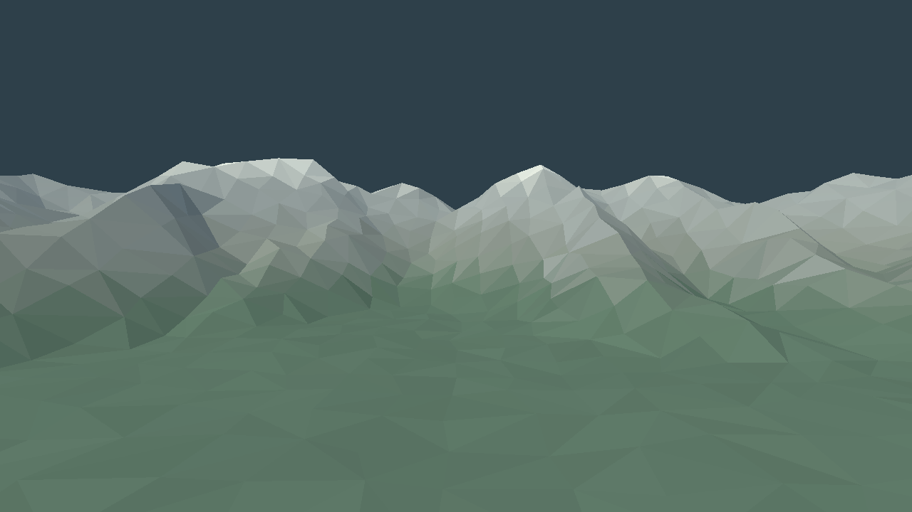

# Mountain Lake & Aurora

> A calm mountain lake under a night sky with a dancing aurora.

Final project for **Computer Graphics Fundamentals** (Astana IT University).
Topic #11 from the *Final Project Topics* list, difficulty ★★ — *course material + one new simple technique*.
The new technique is an **animated aurora shader**.

Planned final scene: a real-time interactive landscape written in **C++** with **OpenGL 3.3 core profile**, featuring mountains built from a heightmap, a semi-transparent lake with strong specular highlights, curved animated aurora ribbons, a starry skybox and a flickering campfire on the shore. The first implementation milestone is described below; the complete course specification remains in this README.

**Planned wow moment (end of the demo video):** the aurora brightens while the camera glides low over the lake.

---

## Contents

- [Status](#status)
- [Features](#features)
- [How the requirements R1–R8 are met](#how-the-requirements-r1r8-are-met)
- [Controls](#controls)
- [Build and run](#build-and-run)
- [Project structure](#project-structure)
- [Technical notes](#technical-notes)
- [Team](#team)
- [Deliverables](#deliverables)
- [Credits](#credits)
- [AI Use note](#ai-use-note)

---

## Status

The current milestone focuses on **terrain only**: a low-poly mountain landscape with sharp peaks and clearly visible triangular faces. The complete mountain-lake scene remains the final target.

- CMake builds GLFW and generated GLAD source locally; GLM and stb_image are bundled as source. No precompiled `.lib` or `.dll` files are needed.
- OpenGL 3.3 core window, shader and indexed-mesh wrappers, fly camera, and a reusable scene-node hierarchy.
- A 513×513 grayscale heightmap covering **560×560 world units**, sampled onto a 128×128-cell mesh with **32,768 triangles**. The larger terrain covers sixteen times the area of the initial 140×140 landscape, while coarse 4.375-unit cells preserve the low-poly look.
- Connected mountain ridges with uneven crests, elevated saddles, shared flanks and descending spurs. Irregularly spaced interior vertices and varied triangle diagonals preserve the low-poly shapes; each triangle has its own geometric normal for flat shading.
- Muted green foothills, grey rock and pale summits, coloured per face by height and slope under ambient and directional light.
- Smooth distance fog and an outer fog band blend the ground into the background before the mesh boundary.
- Keyboard/mouse controls, a window-title FPS counter, CPU tests, and a hidden-window graphics smoke-test mode.



This is an actual 1280×720 application capture. Validation results are recorded in [docs/VALIDATION.md](docs/VALIDATION.md).

The lake, aurora and prop prototype files are retained for later work, but are excluded from the current application build and scene. No water, aurora or campfire is rendered in this milestone. The feature checkboxes below track the **full final feature**, not just its first implementation. See [the implementation roadmap](docs/ROADMAP.md) for the next steps and the R1–R8 status.

| Milestone | What we show | Status |
|---|---|---|
| Team & topic registration | Topic name + every member in MS Teams | ☐ |
| Week 7 progress check | Window, camera, terrain, first objects | Terrain art pass in progress; other objects deferred |
| Week 8 progress check | Lighting, textures, lake, aurora, interaction | ☐ |
| Week 9 progress check | Almost finished project | ☐ |
| Final submission (3 days before defense) | Tag `v1.0`, report PDF, slides, demo video | ☐ |

---

## Features

### Core (required)

- [ ] **Mountain terrain from a heightmap** — grayscale image → grid mesh, heights from pixel brightness, height/slope-based texturing (grass → rock → snow). The current low-poly mesh uses face normals; finite-difference normals remain available for height-field queries.
- [ ] **Lake** — semi-transparent plane (alpha blending, drawn after opaque geometry) with strong Blinn-Phong specular highlights from the moon and the campfire.
- [ ] **Aurora** — several curved quad ribbons with an animated colour shader (scrolling noise + sine waves, green → teal → purple gradient, additive blending).
- [ ] **Starry skybox** — night cubemap.
- [ ] **Campfire point light** — warm, flickering, with distance attenuation.

### Stretch goals (each working one = 4 pts in A5, two = full 8 pts)

- [ ] **Real reflection in the lake** — render the scene mirrored below the water plane into a framebuffer texture, sample it in the lake shader with projective UVs.
- [ ] **Small waves on the lake** — vertex displacement by summed sines and/or scrolling normal map, so highlights and reflection ripple.
- [ ] **Instanced pine trees** — hundreds of trees with `glDrawElementsInstanced`, placed on the terrain by height and slope.

### Extra polish (only if time allows)

- [ ] Aurora light reflected in the lake as a coloured tint.
- [x] Distance fog / mountain haze, including an outer band that obscures the terrain boundary.
- [ ] Campfire spark particles.
- [ ] Dear ImGui panel with all scene parameters.

---

## How the requirements R1–R8 are met

| # | Requirement | Final target | Current terrain milestone |
|---|---|---|---|
| R1 | Modern pipeline | OpenGL 3.3 core; VAO/VBO/EBO; separate `.vert`/`.frag` files; no fixed-function calls. | Core pipeline and reusable resource wrappers. |
| R2 | Scene setup (5+ objects) | Terrain, lake, aurora, skybox, campfire, pines, tent, boat and lantern. | Only terrain is active; additional objects are deferred. |
| R3 | Transformation pipeline + hierarchy | GLM model/view/projection; **boat → lantern** and **campfire → logs/stones** parent–child transforms. | Camera/model matrices and reusable scene-node code; no parent–child object group in the active scene yet. |
| R4 | Lighting / shading | Per-fragment Blinn-Phong; movable directional moon; flickering campfire point light; moving lantern point light. | Flat terrain faces with ambient and directional diffuse lighting; point lights and final material shading are deferred. |
| R5 | Texturing or equivalent | Terrain, logs and tent textures with UVs and mipmaps; night cubemap; procedural aurora. | Heightmap input and per-face terrain colours; textures, cubemap and aurora integration remain. |
| R6 | Interaction | Fly camera, aurora controls, fire toggle, moon movement, time control and wireframe. | Fly camera, directional-light controls, wireframe and mouse capture. Other scene controls are inactive. |
| R7 | Real-time performance | 60+ FPS at 1280×720; FPS counter in title, optionally ImGui. | Title counter; measured performance table still required. |
| R8 | Build | Documented CMake build on a fresh clone, verified on Windows and macOS. | Bundled source dependencies and build/test commands; platform validation must be recorded. |

---

## Controls

These controls apply to the current terrain scene. `H` prints help to the terminal; run from a terminal to see help and diagnostic messages.

| Key / input | Action |
|---|---|
| `W` `A` `S` `D` | Move camera |
| `Space` / `Left Ctrl` | Move up / down |
| Mouse | Look around |
| Mouse wheel | Zoom (field of view) |
| `Left Shift` | Move faster |
| `[` / `]` | Rotate the directional light to inspect mountain faces |
| `P` | Wireframe on / off |
| `H` | Print current controls to the terminal; on-screen help is planned |
| `Tab` | Release / capture the mouse |
| `Esc` | Quit |

Planned bindings for later milestones are `G` for cinematic glide, arrow keys for aurora intensity/speed, `F` for the campfire, `T` for time pause, `M` + mouse drag for the moon, `R` for reflections, and `1`/`2`/`3` for wave presets. They have no action in the current terrain scene. On-screen help is also deferred.

---

## Build and run

Language: C++17. Libraries: **GLFW** (window/input), **GLAD** (loader), **GLM** (math), and **stb_image** (heightmap/image decoding). Their source lives in `external/`; CMake compiles GLFW and GLAD with the application. Versions and licenses are recorded in [external/README.md](external/README.md) and [CREDITS.md](CREDITS.md). Dear ImGui is an optional future addition.

Normal builds do not download dependencies or need Python. Debug and Release each build their own matching libraries, avoiding the runtime mismatch caused by sharing a precompiled Windows `glfw3.lib`.

### Requirements

- CMake ≥ 3.16
- A C++17 compiler: MSVC (Visual Studio 2019+), Clang (Xcode CLT on macOS) or GCC 9+
- GPU and driver with OpenGL 3.3 support
- Windows: install Visual Studio's **Desktop development with C++** workload and a Windows SDK.
- Linux: install the GLFW window-system development packages. On Debian/Ubuntu, `sudo apt install build-essential cmake xorg-dev libwayland-dev libxkbcommon-dev wayland-protocols` supports the default X11/Wayland build. For X11 only, configure with `-DGLFW_BUILD_WAYLAND=OFF` and install `xorg-dev`.

### Steps

```bash
git clone https://github.com/adilzhankad/comp-graph-final.git
cd comp-graph-final
cmake -S . -B build -DCMAKE_BUILD_TYPE=Release
cmake --build build --config Release
```

For Visual Studio 2022, selecting the toolchain and architecture explicitly is recommended on the first configure:

```powershell
cmake -S . -B build -G "Visual Studio 17 2022" -A x64
cmake --build build --config Release
```

Use a separate build directory when changing generators or architecture. Run the executable below. CMake copies `shaders/` and `assets/` beside it, so the working directory does not need to be the repository root:

```bash
# macOS / Linux
./build/MountainLakeAurora

# Windows
build\Release\MountainLakeAurora.exe
```

**Visual Studio / CLion:** open the folder as a CMake project, choose the `MountainLakeAurora` target and run. Rebuild after editing shaders or assets to refresh the executable's resource copies. To load resources from a particular source tree, pass `--resources <directory-containing-shaders-and-assets>`.

### Validation

```bash
cmake -E chdir build ctest -C Release --output-on-failure
```

On CMake 3.20 or newer, `ctest --test-dir build -C Release --output-on-failure` is equivalent.

The CPU tests check camera motion and matrices, transform-hierarchy propagation, heightmap interpolation, normals, input validation and starter asset decoding without a graphics context. Separately, exercise actual context creation, shader compilation, resource loading and drawing with:

```bash
# Windows
build\Release\MountainLakeAurora.exe --smoke-test
# macOS / Linux
./build/MountainLakeAurora --smoke-test
```

The smoke test renders four deterministic frames in a hidden window, checks OpenGL errors and rejects an unexpectedly uniform/dark frame. It returns a nonzero exit code on failure and still requires a working OpenGL driver and display system. To capture the final test frame for visual review, add `--capture smoke.ppm`. The smoke test does not measure FPS or verify keyboard/mouse interaction.

The [build workflow](.github/workflows/build.yml) configures Windows, macOS and Linux builds and CPU tests, plus an Xvfb/Mesa graphics smoke test on Linux. These jobs run after the changes are pushed to GitHub; their existence alone is not evidence of a passing platform build. Record local results and CI outcomes before submission.

> Before submission: check that a **fresh clone** builds with exactly these steps on Windows and macOS.

---

## Project structure

```
comp-graph-final/
├── CMakeLists.txt
├── README.md
├── CREDITS.md            # source/asset provenance and licenses
├── .github/workflows/build.yml # platform build and test jobs
├── docs/ROADMAP.md       # requirement status and ordered follow-up work
├── src/
│   ├── main.cpp          # window, main loop, input dispatch
│   ├── Shader.h/.cpp     # load, compile, link, set uniforms
│   ├── Mesh.h/.cpp       # owning VAO/VBO/EBO wrapper, indexed draw
│   ├── Camera.h/.cpp     # fly camera, frame-rate independent movement
│   ├── SceneNode.h/.cpp  # scene graph: local transform, children, world matrix
│   ├── Scene.h/.cpp      # current terrain-only scene and directional light
│   ├── Heightmap.h/.cpp  # image samples, height and normal lookup
│   ├── ImageLoader.cpp   # the single stb_image implementation translation unit
│   ├── Terrain.h/.cpp    # coarse irregular grid and flat triangle normals
│   ├── Lake.h/.cpp       # deferred prototype, excluded from the application build
│   ├── Aurora.h/.cpp     # deferred prototype, excluded from the application build
│   └── Primitives.h/.cpp # deferred prop geometry, excluded from the application build
├── shaders/
│   ├── terrain.vert / terrain.frag
│   ├── lake.vert    / lake.frag      # deferred prototype
│   ├── aurora.vert  / aurora.frag    # deferred prototype
│   └── object.vert  / object.frag    # deferred prop prototype
├── assets/
│   └── heightmaps/       # bundled reproducible starter heightmap
├── scripts/
│   └── generate_heightmap.py
├── tests/               # CPU behaviour tests
└── external/            # bundled glfw, glad, glm, stb_image sources + versions.json
```

Planned additions include `Texture`, `Skybox`, `Lights`, instanced tree rendering, `assets/textures/`, `assets/skybox/`, and the corresponding shaders. Add these as working modules, following [the roadmap](docs/ROADMAP.md).

Rule of thumb for D2: one class per concept, no application source file over ~500 lines, all shaders in separate `.vert`/`.frag` files. Third-party source is kept separate and retains upstream formatting.

---

## Technical notes

The active renderer currently performs one opaque terrain pass with flat lighting. The terrain section below describes this implementation; the other scene sections preserve the **planned final design** for later milestones.

### Planned final render order per frame

1. *(stretch)* Reflection pass: camera mirrored below the water plane, clip plane `y > waterLevel`, render terrain + trees + campfire + skybox + aurora into a framebuffer.
2. Opaque pass: terrain, trees, campfire, tent, boat.
3. Skybox (depth test `GL_LEQUAL`, depth written as 1.0).
4. Lake — alpha blending, depth write off.
5. Aurora — additive blending (`GL_SRC_ALPHA, GL_ONE`), depth write off, so it glows over the stars.
6. UI (FPS, help, ImGui).

### Terrain from a heightmap

The current asset contains 513×513 grayscale samples spanning 560×560 world units. Heights are decoded as `heightOffset + heightScale · I`, where `I` is pixel brightness in `[0, 1]`. The renderer samples this field onto 128×128 cells, with deterministic interior vertex jitter and varied diagonals, producing 32,768 triangles. Each cell remains roughly 4.375 units wide, so the expanded area keeps large, readable facets. The heightmap generator forms mountains along connected ridge lines: crest heights vary through peaks and saddles, while asymmetric flanks and descending spurs connect them into long ranges. Several overlapping ranges provide depth beyond the open central valley.

Vertices are duplicated between triangles, with one geometric normal shared by all three vertices of each face:

```
n_face = normalize(cross(p1 - p0, p2 - p0))
```

The terrain shaders use `flat` interpolation for the normal and material anchor, preserving constant colour and lighting across each face. Height/slope colour bands, subtle per-face variation and matte directional lighting make the facets readable. Texture integration is a later course milestone and should preserve this low-poly art direction.

Fog uses interpolated world position so the atmospheric transition stays smooth across triangle edges. Distance fog fades in from 95 to 230 units from the camera. A separate outer band fades from 205 to 260 units along either horizontal world axis; it reaches the background colour before the boundary at ±280. This outer band remains in place when the camera approaches the edge, while the central mountain shapes retain their flat shading.

The CPU `Heightmap::normalAt` helper still uses finite differences for slope queries and tests. It does not supply the rendered terrain normals. The original smooth-grid reference is:

```
n = normalize( ( h(i-1,j) - h(i+1,j),  2·cellSize,  h(i,j-1) - h(i,j+1) ) )
```

### Planned material lighting — Blinn-Phong

```
L_out = k_a·I_a + Σ_lights att · ( k_d·max(n·l, 0) + k_s·max(n·h, 0)^shininess ) · I_light
h     = normalize(l + v)
att   = 1 / (1 + k_l·d + k_q·d²)            # point lights only
```

The lake uses a high shininess and specular strength so the moon and campfire leave long bright streaks on the water. Campfire flicker: intensity multiplied by a sum of a few sines with incommensurate frequencies plus small noise.

### Aurora shader

- **Geometry:** each ribbon is a strip of quads along a curve (Catmull-Rom or sine path) high above the lake; `v` runs from the bottom edge to the top edge, `u` along the ribbon.
- **Vertex shader:** sways the ribbon sideways with `sin(u·k + time·speed)`.
- **Fragment shader:**
  - vertical curtain streaks: scrolling 1D/2D value noise in `u` and time;
  - vertical fade: bright, sharp lower edge, soft top — `smoothstep` on `v`;
  - colour gradient by `v`: green at the bottom → teal → purple/pink at the top;
  - output alpha = intensity uniform × streaks × fade, drawn with additive blending.
- **Uniforms:** `uTime`, `uIntensity`, `uSpeed` — changed by keys, and ramped up automatically during the glide for the wow moment.

### Lake

- Large quad (or a fine grid for waves) at `waterLevel`, alpha ≈ 0.6–0.8.
- Fresnel term `F = F0 + (1 − F0)·(1 − cosθ)^5` mixes reflection colour and deep-water colour: more reflective at grazing angles.
- *(stretch)* Reflection: screen-space projective UVs `uv = clip.xy / clip.w · 0.5 + 0.5`, flipped in Y, distorted slightly by the wave normal.

### Instanced pine trees *(stretch)*

One tree mesh (cone + cylinder), per-instance `mat4` model matrix in a VBO with `glVertexAttribDivisor`, positions sampled once at start-up from the terrain (only on slopes below a threshold and above the waterline). Uploaded once — no per-frame uploads of static data (B4).

### Camera

FPS camera with yaw/pitch from the mouse, movement scaled by `deltaTime` so speed does not depend on FPS (C1). The cinematic glide follows a Catmull-Rom spline of control points low over the lake.

---

## Team

| Member | Group | Responsibilities |
|---|---|---|
| _Surname Name_ | _SE-XXXX_ | _e.g. window, camera, scene graph, build system_ |
| _Surname Name_ | _SE-XXXX_ | _e.g. terrain from heightmap, texturing, instanced trees_ |
| _Surname Name_ | _SE-XXXX_ | _e.g. lake: transparency, specular, waves, reflection_ |
| _Surname Name_ | _SE-XXXX_ | _e.g. aurora shader, skybox_ |
| _Surname Name_ | _SE-XXXX_ | _e.g. lights, campfire, UI/ImGui, FPS counter_ |

Every member commits their own work regularly throughout the project and can explain any part of the code at the defense.

---

## Deliverables

- [ ] **Repository** — this README, `CREDITS.md`, shaders in separate files, no build artifacts, commits from every member, tag `v1.0` on the submission date.
- [ ] **Report** (PDF, Final Project Report Template) — Introduction, Literature Review (15+ Q1–Q2 sources), Project Description, Technical Implementation, Graphics and Rendering, Testing and Evaluation with FPS table, Conclusion and Future Work, References, AI Use Note.
- [ ] **Slides** — 8–12 slides, 7–10 minutes, every member presents a part.
- [ ] **Demo video** — 3–6 minutes, 1080p, real-time capture with the FPS counter visible, voice-over or captions naming each R1–R7 feature and each stretch goal, ending on the wow moment.

### FPS table (filled in during testing)

| Machine | CPU | GPU | OS | Resolution | Avg FPS | Min FPS |
|---|---|---|---|---|---|---|
| | | | | 1280×720 | | |

---

## Credits

All third-party assets (heightmaps, textures, skybox, models), shader snippets and tutorials are listed in [`CREDITS.md`](CREDITS.md) with author, link and license.
Code adapted from LearnOpenGL or the course labs is also cited in a comment next to the code.

---

## AI Use note

Required by the course rules; kept up to date during the project and copied into the report.

| Tool | What it was used for | What we changed / checked |
|---|---|---|
| Claude (Anthropic) | Drafted the initial structure of this README from the course requirements and topic description. | _Team reviewed and edited the text; fill in further uses here._ |
| Codex (OpenAI) | Created the CMake/source-dependency setup, initial scene prototypes, CPU tests and roadmap; revised the active milestone to terrain only with sharp low-poly geometry and flat shading. | Build and rendering evidence is recorded in `docs/VALIDATION.md`. Team must review the terrain appearance, exercise the controls and explain the implementation at the defense. |
